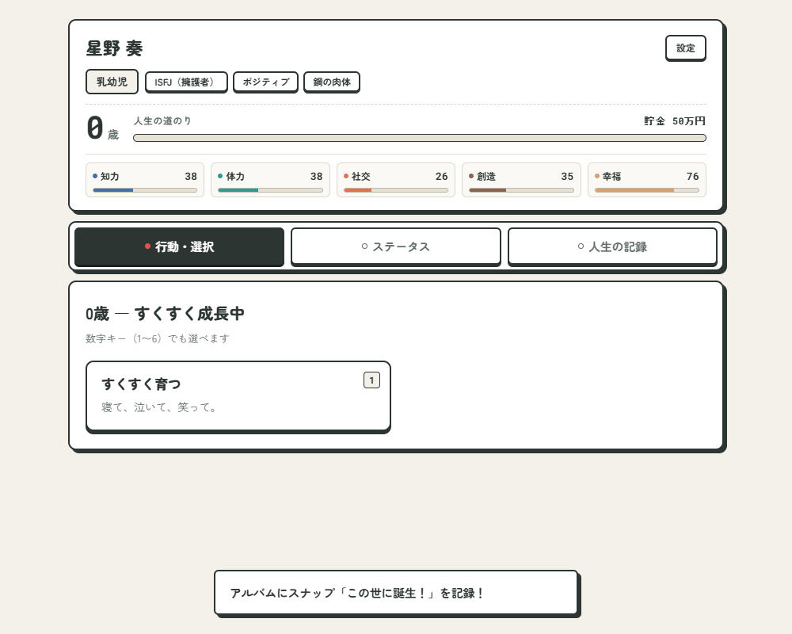
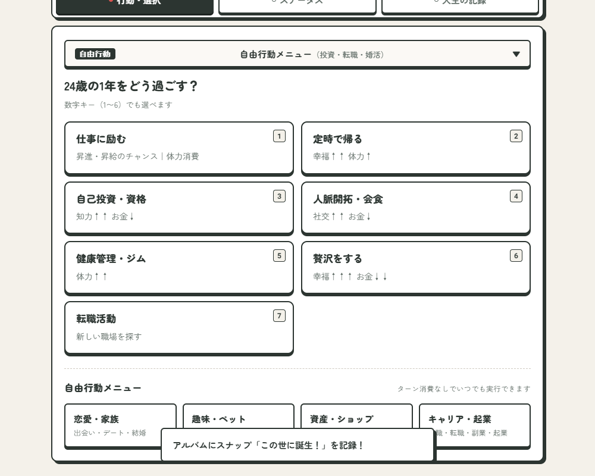
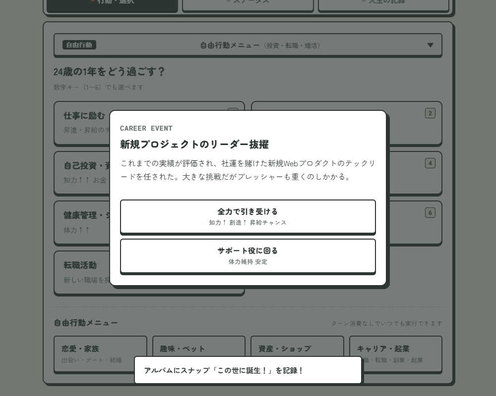
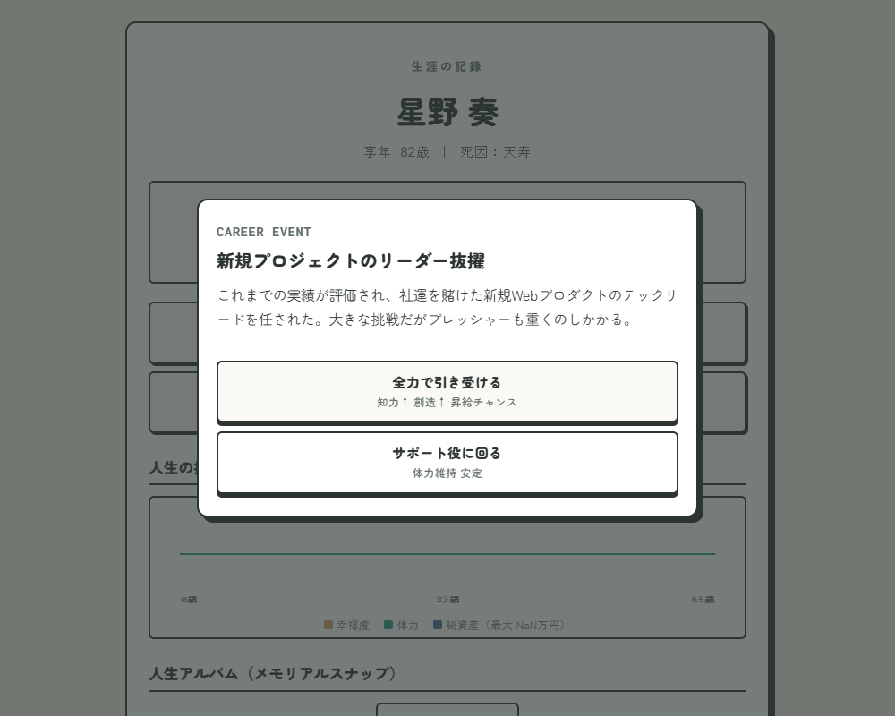

# 🌟 LIFE — ひとつの人生 (LIFE Simulation Game)

<div align="center">


**0歳の誕生から学生時代、就職・結婚・趣味・資産運用、そして老後・臨終まで――**  
**1年1ターンの選択で歩む、手帳・ボードゲーム風の本格テキスト人生シミュレーションゲーム**

### 🎮 [▶ ブラウザで今すぐプレイする（公開URL）](https://life.xcangcheng.workers.dev/)
*(PC・スマートフォン両対応 / インストール・会員登録不要 / PWAホーム画面追加対応)*

</div>

---

## 📸 プレイ画面ギャラリー

<div align="center">

| メインゲーム画面（年次行動カード） | ライフスタイル（趣味・ペット・移住） |
| :---: | :---: |
|  |  |

| イベント・マイルストーンモーダル | エンディング・人生アルバム（スナップ） |
| :---: | :---: |
|  |  |

</div>

---

## 🎨 デザインコンセプト：上質な手帳 × クラシック・ボードゲーム

本作は、画面を見つめながら自らの人生を記録・回顧する体験を大切にするため、**「上質な手帳（Planner / Journal）」** と **「クラシック・ボードゲーム」** の質感を融合したUI/UXへと全面リニューアルしました。

* **紙とインクの温もりあるカラーパレット**: 生成りの紙面（Paper Cream `#fcfaf5`）をベースに、深みのある万年筆インク（Charcoal `#2c2825`）とアンティークゴールド（Accent `#8a6d2b`）を基調としています。
* **心地よいタイポグラフィ**: 日本語テキストには親しみやすく落ち着いた丸ゴシック「**Zen Maru Gothic**」、ステータスや数値パラメータには手帳の活字のような「**Roboto Mono**」を適用。
* **物理的な手触り感**: ペーパークラフト調のカードシャドウ（Paper Lift）、押印のようなステータススタンプ、インクが乗ったようなバッジ装飾など、細部までクラフトマンシップを宿しています。

---

## 🕹️ ゲームの概要と基本操作フロー

### 1. ゲーム概要
プレイヤーは0歳の子どもとして誕生し、毎年提示される「3枚の年次行動カード」から1つを選びながら人生を歩みます。  
生まれ持った才能（Traits）や16タイプのMBTI性格、学生時代の学業・部活動、就職・昇進・転職、恋愛・結婚・子育て、資産運用（株式・不動産・カジノ）など、プレイヤーの選択と時代のトレンドによって無数の人生ドラマが紡がれます。

### 2. 基本操作フロー
```
   [1. 年次行動カードを選択]
               ↓
   [2. 行動結果トースト（3秒表示） ＆ イベントモーダル即時展開]
               ↓
 ┌───────────────────────┴───────────────────────┐
 │ 【イベントが発生した場合】                    │ 【イベントがない場合】
 │ ノンブロッキングでイベントモーダルが即時展開。 │ 画面下のトースト（3秒フェード）を眺めつつ、
 │ トーストは背景下部に3秒間自然に表示され、      │ 次の年の行動カードを迷わず連続タップして
 │ 選択肢をじっくり吟味できる。                 │ 軽快なテンポでテンポよく進められる。
 └───────────────────────┬───────────────────────┘
                         ↓
         [3. 自由行動・人生アルバムの充実]
     (15歳以降：恋愛、ペット、趣味、投資、起業など)
                         ↓
               [4. 臨終・エンディング]
      (人生ステータス推移グラフ、称号、アルバム鑑賞)
```

---

## 🛠️ 使用技術と選定理由

| カテゴリ | 使用技術 / ツール | 選定理由・役割 |
| :--- | :--- | :--- |
| **フロントエンド** | **HTML5 / CSS3 / Vanilla JavaScript (ES6+)** | フレームワーク非依存（ゼロ依存）。ビルド工程を省き、描画・更新速度を極限まで高め、ポータビリティを最大化。 |
| **モバイル / PWA** | **PWA Manifest / Safe Area API (`viewport-fit=cover`)** | スマホのホーム画面追加による全画面ネイティブアプリ化。iPhoneのノッチ・ホームバー対応と`100dvh`適応。 |
| **音響（Audio）** | **Web Audio API (Synthesizer)** | 外部MP3ファイル等のロードをゼロ化。オシレーター波形生成による超軽量・低遅延な効果音（クリック音・ファンファーレ等）。 |
| **可視化（Data Viz）** | **HTML5 Canvas API** | 人生終了時の「5大ステータス生涯推移グラフ」を動的ベクター描画。 |
| **データ永続化** | **LocalStorage API** | 毎ターンリアルタイム自動セーブ、殿堂入りTOP10、実績・職業・才能図鑑、ユーザー音量設定の保存。 |
| **インフラ / デプロイ** | **Cloudflare Workers (Static Assets / `wrangler.json`)** | 最新のWrangler構成。GitHub連携による超高速エッジ自動デプロイ・グローバルCDN配信。 |
| **開発支援・AIペア** | **Google Antigravity** | Google DeepMind の先端エージェント技術を用いたペアプログラミング・設計最適化・リファクタリング。 |
| **テスト・品質保証** | **Python / Playwright** | ヘッドレスブラウザによるシナリオ自動E2Eテスト（リロード耐性、画面キャプチャ、UI干渉検証）。 |

---

## 💡 【技術的なこだわり・設計の工夫】

### 1. ゼロ依存（Zero Dependencies）と瞬時起動の追求
* 外部ライブラリや重厚なSPAフレームワークを一切導入せず、純粋なVanilla JSとCSSのみで構築しました。
* 音声アセットも外部音声ファイルをロードせず、**Web Audio APIを用いて周波数・エンベロープ（ADSR）をリアルタイム合成**しています。これにより、**初回ロード時間ほぼ0秒、通信量数十キロバイトでの瞬時起動**を実現しています。

### 2. PWA対応とネイティブアプリ並みの操作性
* Webアプリでありながら、スマホの「ホーム画面に追加」を行うことでアドレスバーのない全画面スタンドアロン起動が可能。
* オリジナルデザインのPWAアプリアイコン（SVGおよび各解像度PNG）を自作し、`apple-touch-icon` や `manifest.json` を整備。
* iOSのノッチ（Dynamic Island）やホームインジケーターにコンテンツが重ならないよう、`viewport-fit=cover` と `env(safe-area-inset-*)` を緻密に計算し、余白を自動最適化しています。

### 3. 堅牢な単一状態管理（Normalized State Machine）
* プレイヤーの人生の全状態はグローバルなステートオブジェクト `S` で一元管理され、毎ターンの行動決定時に `saveCurrentGame()` で `localStorage` へアトミックに同期されます。
* 過去のセーブデータやバージョン差異による不整合を防ぐため、`ensureState()` によるフォールバック機構を導入し、安全なデータマイグレーションを保証しています。

### 4. いつでも中断・再開できる設定システム
* プレイ画面右上の「⚙️ 設定ボタン」から、ゲーム進行を阻害することなく**効果音のON/OFF**や**セーブを保持したままのメインメニュー復帰**が可能です。
* ユーザーの設定（音の有無など）はプレファレンスとしてLocalStorageに即時保存され、次回起動時にも引き継がれます。

---

## 🔥 【開発中に直面した課題と解決エピソード】

### 課題1: リロードによる「不正なやり直し（リセマラ）」と画面断絶
* **【直面した課題】**:  
  ブラウザゲーム特有の問題として、「転職活動や大勝負イベントで望まない結果が出た際にページをリロードして巻き戻す」リセマラ行為が可能になっていました。また、プレイ途中でリロードした際に毎回タイトル画面に戻されてしまい、再開の手間がかかるというUX上の課題がありました。
* **【解決アプローチ】**:  
  1. 起動時に `localStorage` のセーブ状態と最終画面を検知し、タイトルを経由せず**直接プレイ中のゲーム画面へ即座に自動復帰**するレジューム機構を構築。
  2. 行動カードを選択した瞬間に `S.turnActed = true` および保留中のイベント識別子（`pendingActionId`）をリアルタイム保存。
  3. もし転職モーダル表示中にリロードされた場合でも、**カード選択画面には戻さず、転職求人モーダルを目の前に強制自動復帰**させるターン永続化ステートマシンを実装。これにより、不正な再抽選を物理的に防止しました。

### 課題2: テンポと情報伝達を両立する「ノンブロッキング3秒トースト」への進化
* **【直面した課題】**:  
  当初は行動直後のステータス変化トーストを自動で消さず、「画面タップを待ってからイベントを開く」ブロッキング仕様にしていました。しかし、これではテンポよく進めたいプレイヤーにとって「1手余計なタップ」が必要になり、プレイの軽快感を損ねていました。
* **【解決アプローチ】**:  
  1. 行動カード選択時にトーストを表示しつつ、イベントがある場合は**待たずに即時モーダルを展開するノンブロッキング設計**へと改修。
  2. トーストは3秒間自然に表示された後に自動消去されるタイマーを付与し、さらに「次のカード選択」や「モーダル操作」の邪魔にならないよう背景下部に控えめに配置。
  3. 連続でカードを選択した場合も、既存のタイマーを即時クリアして最新の結果に上書きすることで、タイマーの競合や表示の乱れを完全に解消しました。

### 課題3: PWAスタンドアロン起動時におけるiOSノッチ／Safe Areaの食い込み
* **【直面した課題】**:  
  スマホのホーム画面から起動（スタンドアロンモード）した際、SafariのURLバーが消える一方で、画面上部がステータスバーやノッチ領域に食い込んでヘッダー文字が見切れたり、画面外をスクロールした際に背景の原稿用紙マス目が意図せず露出する問題が発生しました。
* **【解決アプローチ】**:  
  1. `index.html` の viewport に `viewport-fit=cover` を明示し、CSS側で `padding-top: max(8px, env(safe-area-inset-top))` を指定してノッチとの物理的な安全距離を確保。
  2. 画面の高さを従来の `100vh` からモバイルのアドレスバー伸縮に追従する `100dvh`（Dynamic Viewport Height）へ刷新し、`box-sizing: border-box;` で厳密に収めました。
  3. スクロール時のマス目露出に対しては、親コンテナの背景色（Paper Cream）と疑似要素のサイズをビューポート全体にしっかり敷き詰め、はみ出し時でも自然な紙面質感が途切れないよう境界処理を施しました。

### 課題4: ゼロ依存でのWeb Audioシンセサイザーとアクセシビリティ
* **【直面した課題】**:  
  音声ファイルを使わずに心地よい効果音を作るためWeb Audio APIを採用しましたが、ブラウザの自動再生ポリシー（Autoplay Policy）によるブロックや、公共の場などで「音を消したい」というユーザーへの配慮が必要でした。
* **【解決アプローチ】**:  
  1. 最初のユーザー操作（クリック・タップ）をトリガーに `AudioContext.resume()` を呼び出す安全なアンロック機構を構築。
  2. 正弦波（sine）や三角波（triangle）の周波数を時間軸で微細にベンドさせることで、心地よいクリック音や歓喜のファンファーレを合成。
  3. 画面右上に「⚙️ 設定ボタン」を新設し、ワンタップでSEを完全ミュートできるトグルスイッチを実装。設定はLocalStorageに永続化し、いつでもストレスフリーに遊べるアクセシビリティを確保しました。

---

## 📈 開発履歴と今後のロードマップ

詳細なコミットごとの日別実装記録、および今後のリファクタリング・ゲームデザイン改善課題（巨大単一ファイルのモジュール分割、イベントのデータ駆動化、クリティカル演出など）については、以下のドキュメントにまとめています。

👉 [**開発日記 (`DEVLOG.md`) を読む**](DEVLOG.md)

---

## 📄 ライセンス

本プロジェクトのソースコードおよびアセットの著作権は制作者に帰属します。
